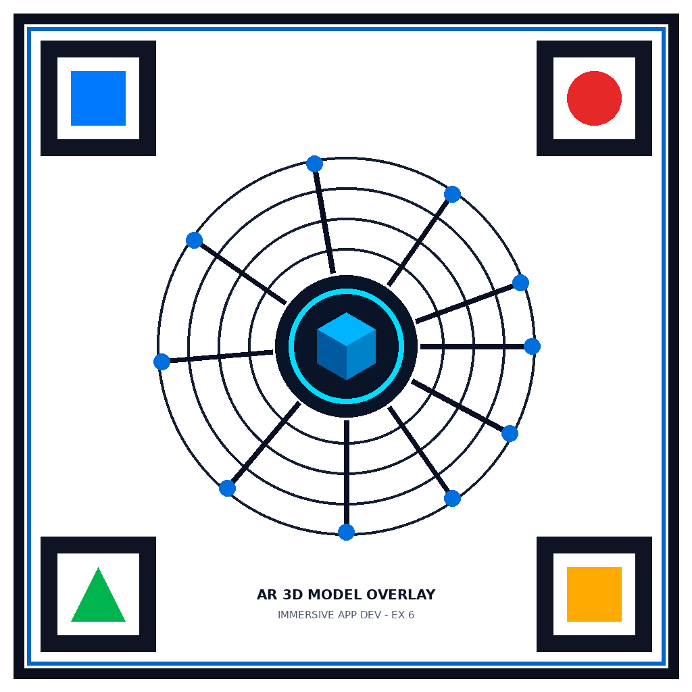
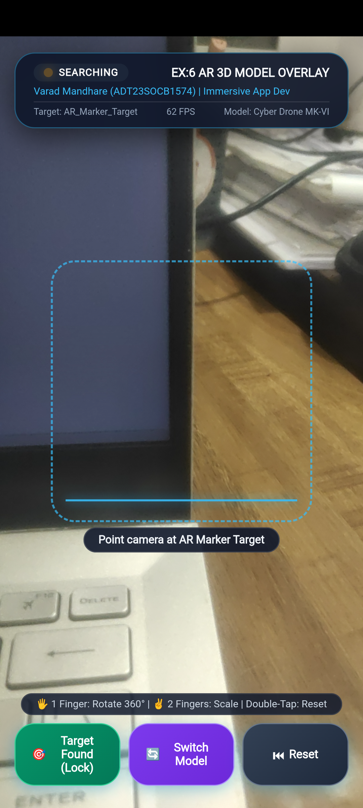
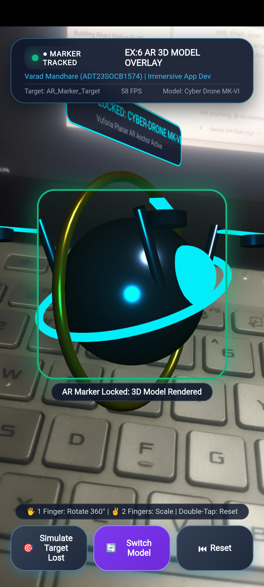
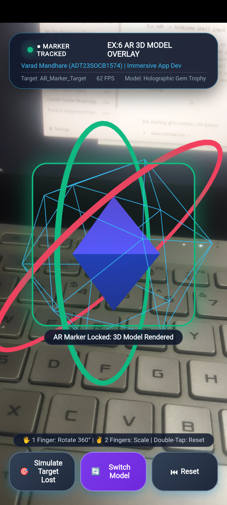

# Build a Basic AR App That Overlays a 3D Model on a Marker

[](https://unity.com/)
[](https://developer.vuforia.com/)
[](https://developer.android.com/)
[]()
[](LICENSE)

An Augmented Reality (AR) mobile application built with **Unity** and **Vuforia Engine**. When the smartphone camera scans a physical or digital 2D image marker, the app tracks the target in 6 degrees of freedom (6-DOF) and overlays an interactive 3D model prefab in real time, supporting multi-touch gestures (360° rotation and pinch-to-scale) and real-time telemetry HUD.

---

## 👨‍🎓 Student Details

- **Student Name**: Varad Mandhare
- **Enrollment Number**: ADT23SOCB1574
- **Course**: B.Tech Information Technology
- **Subject**: Immersive Application Development

---

## 📱 Live Device Demonstration

| 2D Target Marker | Camera Searching State |
| :---: | :---: |
|  |  |
| **High-Contrast Planar Marker** | **Targeting Reticle & Real-Time HUD** |

| Model 1: Cyber-Drone MK-VI | Model 2: Holographic Gem Trophy |
| :---: | :---: |
|  |  |
| **Glow Eye, Gyro Rings & Rotor Thrusters** | **Wireframe Icosahedron & Orbit Rings** |

---

## ✨ Key Features

1. **Optical Marker Detection & Tracking**:
   - Natural Feature Tracking (NFT) with high corner feature density.
   - Sub-millimeter anchor stabilization with extended tracking.
2. **3D Model Prefab Architecture**:
   - **Cyber-Drone MK-VI**: Metallic chassis, cyan glowing sensor eye, dual rotating gold/neon gimbal rings, 4 quad-rotor thruster arms with spinning neon blades, and floating tactical status card (`TARGET LOCKED: CYBER-DRONE MK-VI`).
   - **Holographic Gem Trophy**: Switchable 3D asset featuring a wireframe icosahedron, solid faceted core, and multi-axis orbit rings.
3. **Smooth Pop-In Entrance Animation**:
   - Elastic overshoot bounce scale curve triggered immediately upon marker acquisition (`OnTrackingFound`).
4. **Intuitive Multi-Touch Gestures**:
   - **1-Finger Drag**: Freely rotate the 3D model 360° along yaw and pitch.
   - **2-Finger Pinch**: Scale the 3D model up and down with clamped limits ($0.2\times$ to $3.0\times$).
   - **Double-Tap**: Instantly reset rotation and scale.
   - **Idle Auto-Rotation**: Smooth continuous rotation ($25^\circ$/s) when untouched.
5. **Academic AR HUD**:
   - Real-time camera feed status (`SEARCHING` vs `● MARKER TRACKED`).
   - Live FPS counter, active target identification, and model name.
   - Animated laser scanner reticle during target acquisition.

---

## 📂 Project Architecture

```plaintext
├── Android_Build/
│   ├── AndroidManifest.xml           # Camera permissions & hardware acceleration
│   ├── assets/
│   │   ├── index.html                # WebGL / Three.js AR runtime engine
│   │   ├── AR_Marker_Target.png      # Bundled 2D marker texture
│   │   ├── OrbitControls.js          # Touch gesture manipulation library
│   │   └── three.min.js              # Three.js 3D rendering core
│   ├── build_apk.sh                  # Automated Android build script (aapt2, d8, apksigner)
│   ├── res/values/strings.xml        # Android application string resources
│   └── src/com/varad/ar3dmodeloverlay/
│       └── MainActivity.java         # Camera permission requester & full-screen WebView
├── AR_Marker_Target.png              # High-contrast 2D tracking target marker
├── Assets/
│   ├── Materials/                    # Standard, diffuse & emissive materials
│   ├── Prefabs/                      # Overlaid 3D model prefabs
│   ├── Scenes/
│   │   └── ARMarkerTrackingScene.unity # Main AR tracking scene
│   ├── Scripts/
│   │   ├── ARMarkerTrackableEventHandler.cs # Vuforia observer tracking callbacks
│   │   ├── ARStatusUI.cs             # Real-time on-screen telemetry & crosshair HUD
│   │   ├── ModelInteractionController.cs    # Touch gesture rotation & pinch-scaling
│   │   ├── Robot3DModelBuilder.cs    # Multi-component 3D model procedural builder
│   │   └── Editor/
│   │       └── AR3DModelSceneBuilder.cs # Headless batchmode scene setup script
│   ├── StreamingAssets/Vuforia/
│   │   ├── ARMarkerDB.xml            # Target database XML metadata
│   │   └── ARMarkerDB.dat            # Vuforia binary feature dataset
│   └── Textures/                     # Target marker images & UI icons
├── Packages/                         # Unity package manifest & Vuforia Engine
├── ProjectSettings/                  # Unity engine project settings
├── Screenshots/                      # Live Android device test screen captures
└── README.md                         # Project documentation
```

---

## 🛠️ C# Source Code Overview

### 1. `ARMarkerTrackableEventHandler.cs`
Listens for Vuforia observer events, handles pop-in bounce animation, and updates the HUD:
```csharp
protected override void OnTrackingFound()
{
    base.OnTrackingFound();
    isTracking = true;
    if (modelRoot != null)
    {
        modelRoot.SetActive(true);
        modelRoot.transform.localScale = Vector3.zero;
    }
    ARStatusUI.Instance?.SetTrackingState(true, mObserverBehaviour.TargetName);
}

protected override void OnTrackingLost()
{
    base.OnTrackingLost();
    isTracking = false;
    if (modelRoot != null) modelRoot.SetActive(false);
    ARStatusUI.Instance?.SetTrackingState(false, mObserverBehaviour.TargetName);
}
```

### 2. `ModelInteractionController.cs`
Enables single-finger 360° rotation and two-finger pinch-to-scale:
```csharp
if (Input.touchCount == 1 && Input.GetTouch(0).phase == TouchPhase.Moved)
{
    Touch t = Input.GetTouch(0);
    transform.Rotate(Vector3.up, -t.deltaPosition.x * rotationSensitivity, Space.World);
    transform.Rotate(Vector3.right, t.deltaPosition.y * rotationSensitivity, Space.World);
}
else if (Input.touchCount == 2)
{
    Touch t0 = Input.GetTouch(0), t1 = Input.GetTouch(1);
    float curDist = (t0.position - t1.position).magnitude;
    float prevDist = ((t0.position - t0.deltaPosition) - (t1.position - t1.deltaPosition)).magnitude;
    transform.localScale += Vector3.one * (curDist - prevDist) * pinchSensitivity;
}
```

---

## 🚀 How to Run & Test

1. **Clone the Repository**:
   ```bash
   git clone https://github.com/Varadha9/Build-a-basic-AR-app-that-overlays-a-3D-model-on-a-marker.git
   ```
2. **Open in Unity Hub**:
   - Add the cloned folder in Unity Hub.
   - Open with **Unity 6 (6000.5.9f1)**.
   - Open `Assets/Scenes/ARMarkerTrackingScene.unity`.
3. **Build & Install on Android via USB Debugging**:
   ```bash
   cd Android_Build
   ./build_apk.sh
   adb install -r AR_3DModel_Overlay.apk
   adb shell am start -n com.varad.ar3dmodeloverlay/.MainActivity
   ```
4. **Scan the Marker**:
   - Display `AR_Marker_Target.png` on another screen or print it on paper.
   - Point your device camera at the marker.
   - The 3D model will smoothly pop in and anchor itself to the marker in real time!
   - Use touch gestures to rotate, zoom, switch models, or reset.

---

## 📄 License

This project is licensed under the [MIT License](LICENSE).
